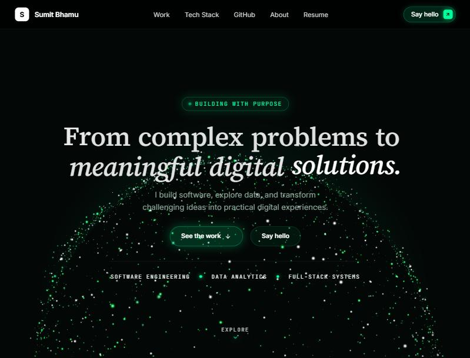
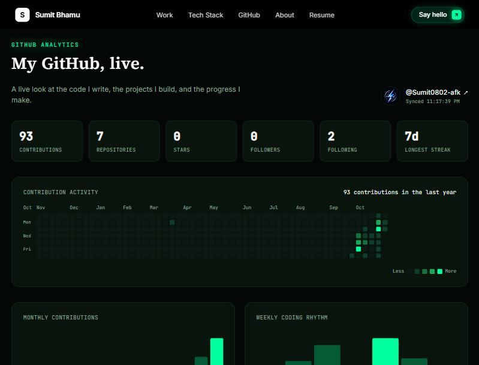
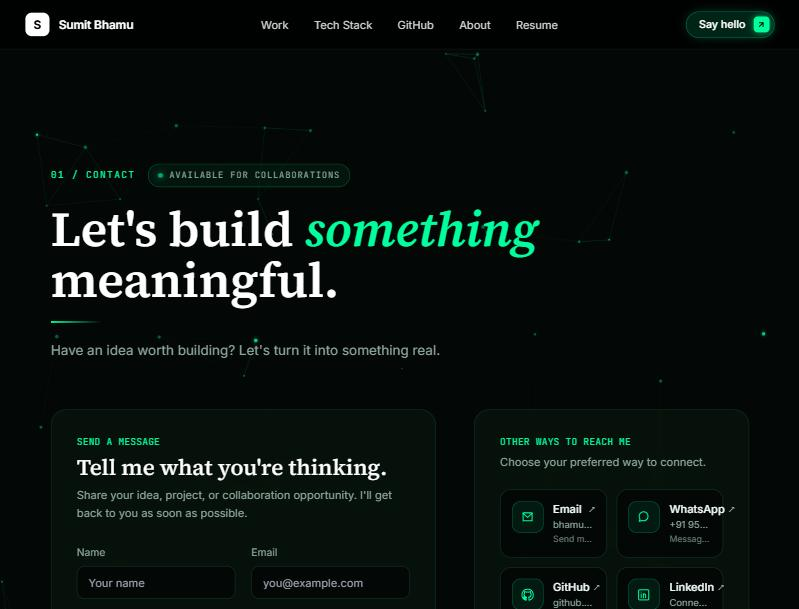
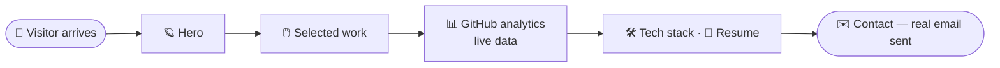

<!-- Header -->
<p align="center">
  
</p>

<!-- Views -->
<p align="right">
  <a href="https://github.com/Sumit0802-afk/Portfolio_sumit">
    
  </a>
</p>

<!-- Typing SVG -->
<p align="center">
  <a href="https://portfolio-sumit.vercel.app">
    
  </a>
</p>

<!-- Links -->
<p align="center">
  <a href="https://portfolio-sumit.vercel.app" target="_blank">
    
  </a>&nbsp;
  <a href="https://github.com/Sumit0802-afk/Portfolio_sumit" target="_blank">
    
  </a>&nbsp;
  <a href="#-quick_start">
    
  </a>&nbsp;
  <a href="#-deploy">
    
  </a>
</p>

<p align="center">
  
  
  
  
  
  
  
</p>

<br>

<!-- At a glance -->
<table align="center">
  <tr>
    <td align="center" width="25%" valign="top">
      <h3>🪐</h3>
      <b>Hero</b><br>
      <sub>Particle globe, spring-text reveal, a bokeh cursor trail</sub>
    </td>
    <td align="center" width="25%" valign="top">
      <h3>📊</h3>
      <b>GitHub analytics</b><br>
      <sub>Heatmap, streaks, charts — fetched live, not hand-typed</sub>
    </td>
    <td align="center" width="25%" valign="top">
      <h3>🖱️</h3>
      <b>Selected work</b><br>
      <sub>A GSAP scroll-pinned horizontal gallery of real projects</sub>
    </td>
    <td align="center" width="25%" valign="top">
      <h3>✉️</h3>
      <b>Contact</b><br>
      <sub>A form that actually sends mail, with a particle background</sub>
    </td>
  </tr>
</table>

<br>

<p align="center">
  
  
</p>
<p align="center">
  
</p>

<br>

<blockquote align="center">
  <b>A portfolio should be as carefully built as the projects it links to.</b>
</blockquote>

<!-- Visitor flow -->


<br>

<!-- About -->
## `> about.ts`

```typescript
const portfolio = {
    tagline: "From complex problems to meaningful digital solutions.",
    what: "A personal portfolio — projects, toolkit, resume and a live contact form",
    liveDemo: "https://portfolio-sumit.vercel.app",
    sections: ["Selected work", "Tech stack", "GitHub analytics", "About", "Resume", "Contact"],
    stack: {
        frontend: ["React 18", "TypeScript", "Vite", "Tailwind CSS", "React Router"],
        motion: ["GSAP", "@react-spring/web", "spring-text-engine"],
        threeD: ["Three.js"],
        backend: ["Vercel serverless function (api/gh.ts)"]
    },
    belief: "A portfolio should be as carefully built as the projects it links to."
};
```

<p align="center">
  
</p>

<!-- Tech Stack -->
## `> tech_stack`

<p align="center">
  <a href="https://skillicons.dev">
    
  </a>
</p>

<p align="center">
  
</p>

<!-- Features -->
## `> features`

<table align="center">
  <tr>
    <td width="33%" valign="top">
      🪐 &nbsp;<b>Hero</b><br>
      <sub>Particle globe, spring-text headings, bokeh cursor trail</sub>
    </td>
    <td width="33%" valign="top">
      🖱️ &nbsp;<b>Selected work</b><br>
      <sub>GSAP scroll-pinned horizontal gallery, repo + demo links</sub>
    </td>
    <td width="33%" valign="top">
      📊 &nbsp;<b>GitHub analytics</b><br>
      <sub>Heatmap, streaks, language mix, sortable repos, activity feed</sub>
    </td>
  </tr>
  <tr>
    <td width="33%" valign="top">
      🛠️ &nbsp;<b>Tech stack</b><br>
      <sub>Brand icons for every tool actually used, grouped by category</sub>
    </td>
    <td width="33%" valign="top">
      📄 &nbsp;<b>Resume</b><br>
      <sub>Full timeline and skills inline, plus a one-click PDF download</sub>
    </td>
    <td width="33%" valign="top">
      ✉️ &nbsp;<b>Contact</b><br>
      <sub>Working form (Web3Forms), five social cards, particle background</sub>
    </td>
  </tr>
</table>

<details>
<summary><b>Every feature, in detail</b></summary>
<br>

```typescript
const githubAnalytics = {
    source: "the real GitHub REST API + a public contribution-calendar API",
    heatmap: "52 weeks of daily contributions, hover tooltips, a Less→More legend",
    kpis: ["contributions", "repositories", "stars", "followers", "following", "longest streak"],
    charts: ["monthly contributions", "weekly coding rhythm"],
    repos: "sortable — recently updated, most starred, alphabetical",
    activity: "recent public events — pushes, PRs, issues, new repos",
    rule: "never fabricates a number; shows a retry state if the API is unreachable"
};

const contact = {
    fields: ["Name", "Email", "Project type", "Message"],
    delivery: "Web3Forms — a real email, not a mailto: link",
    background: "a canvas particle network, cursor-reactive, pointer-events: none",
    socials: ["Email", "WhatsApp", "GitHub", "LinkedIn", "Instagram"]
};

const motion = {
    text: "spring-text-engine — every heading animates in letter by letter",
    scroll: "GSAP ScrollTrigger — the horizontal project gallery pins and scrubs",
    cursor: "a canvas bokeh trail follows the pointer, off on touch devices",
    rule: "respects prefers-reduced-motion everywhere"
};
```

</details>

<p align="center">
  
</p>

<!-- Quick start -->
## `> quick_start`

You need: Node.js 18+ and npm.

```bash
# 1. clone
git clone https://github.com/Sumit0802-afk/Portfolio_sumit.git
cd Portfolio_sumit

# 2. install
npm install

# 3. run  ->  http://localhost:5173
npm run dev
```

<!-- Config -->
## `> config.env`

Copy `.env.local.example` to `.env.local` and fill in what you need — both are optional, the
site works without them, just with a lower GitHub API rate limit and a disabled contact form.

```bash
# raises the GitHub Analytics section's rate limit from 60/hr to 5000/hr in dev
VITE_GITHUB_TOKEN=

# makes the contact form actually send mail — get a free key at web3forms.com
VITE_WEB3FORMS_KEY=
```

<!-- Architecture -->
## `> architecture`
```
src/
├── pages/              one file per route — Home, Work, About, Resume, Contact, ...
├── components/
│   ├── github/          the GitHub Analytics dashboard (heatmap, charts, repo grid, activity)
│   ├── ui/               shared primitives — Heading, SectionHeading, TechTag
│   └── *.tsx             Navbar, Footer, Hero, CursorBokeh, ProjectCard, ...
├── data/                 profile, projects, skills, notes — all the site's content
└── lib/github.ts         GitHub REST + contribution-calendar API client

api/gh.ts                 Vercel serverless proxy for the GitHub API (keeps a token server-side)
```

<!-- Deploy -->
## `> deploy`

Builds as a static site with one serverless function, deployed on Vercel.

```yaml
frontend:
  host: Vercel
  buildCommand: npm run build
  outputDirectory: dist
  env: { GITHUB_TOKEN: "<optional, raises the shared rate limit to 5000/hr>" }

contactForm:
  env: { VITE_WEB3FORMS_KEY: "<same key as .env.local>" }
```

<!-- Roadmap -->
## `> roadmap`

| | |
|---|---|
| ✅ **Selected work** | Horizontal scroll gallery, project detail pages, repo + live links |
| ✅ **GitHub analytics** | Heatmap, streaks, charts, repo grid, activity feed |
| ✅ **Contact** | Working form, social cards, particle background |
| 🔜 **Notes** | A small written-notes section — structure is in, content is still thin |
| 🔜 **Tests** | No automated tests yet, just `tsc` and a production build on every change |

<p align="center">
  
</p>

<!-- Author -->
## `> author`

<table align="center">
  <tr>
    <td align="center">
      <br>
      <b>Sumit Bhamu</b><br>
      <sub>B.Tech CSE (Data Analytics), VIT-AP University</sub><br><br>
      Designed, built and deployed this portfolio — layout, motion, the GitHub analytics
      dashboard, and the contact pipeline.<br><br>
      <a href="https://github.com/Sumit0802-afk"></a>
      <a href="https://www.linkedin.com/in/sumit-bhamu-631819334/"></a>
    </td>
  </tr>
</table>

<p align="center">
  
</p>
